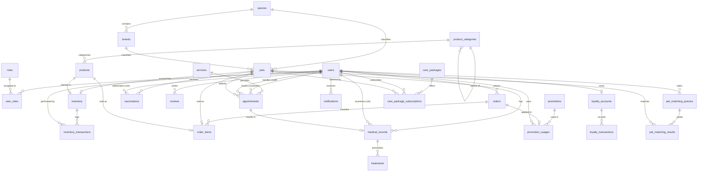

# PetCare Hub Database Schema Documentation

## 1. Database Overview

The application uses **Microsoft SQL Server**. The tables below describe the logical model; authoritative DDL is versioned in backend/src/main/resources/db/migration. Follow [the Flyway runbook](migrations.md) for new databases and existing-data onboarding. Older manual migration instructions below are historical mappings, not deployment commands.

*   **Primary Keys**: All tables use `BIGINT IDENTITY(1,1)` as the primary key.
*   **Audit Trail**: Standard audit columns (`created_at` and `updated_at`) are present on all core tables to track data modifications.

---

## 2. ER Diagram



---

## 3. Table Details

### User & Auth

#### `users`
*   **id**: `BIGSERIAL` (PK)
*   **username**: `VARCHAR(50)` (UNIQUE, NOT NULL)
*   **email**: `VARCHAR(255)` (UNIQUE, NOT NULL)
*   **password_hash**: `VARCHAR(255)` (NOT NULL)
*   **first_name**: `VARCHAR(100)` (NOT NULL)
*   **last_name**: `VARCHAR(100)` (NOT NULL)
*   **phone**: `VARCHAR(20)`
*   **avatar_url**: `VARCHAR(255)`
*   **enabled**: `BOOLEAN` (NOT NULL, DEFAULT true)
*   **created_at**: `TIMESTAMP` (NOT NULL, DEFAULT CURRENT_TIMESTAMP)
*   **updated_at**: `TIMESTAMP` (NOT NULL, DEFAULT CURRENT_TIMESTAMP)

#### `roles`
*   **id**: `BIGSERIAL` (PK)
*   **name**: `VARCHAR(50)` (UNIQUE, NOT NULL) - Enum values: CUSTOMER, SALES_STAFF, WAREHOUSE_STAFF, VETERINARIAN, ADMIN
*   **description**: `TEXT`

#### `user_roles`
*   **user_id**: `BIGINT` (PK, FK to `users`, ON DELETE CASCADE)
*   **role_id**: `BIGINT` (PK, FK to `roles`, ON DELETE CASCADE)

### Pet Domain

#### `species`
*   **id**: `BIGSERIAL` (PK)
*   **name**: `VARCHAR(100)` (UNIQUE, NOT NULL) - e.g., Dog, Cat, Bird, Fish, Reptile, Small Animal
*   **description**: `TEXT`

#### `breeds`
*   **id**: `BIGSERIAL` (PK)
*   **species_id**: `BIGINT` (FK to `species`, NOT NULL)
*   **name**: `VARCHAR(100)` (NOT NULL)
*   **description**: `TEXT`
*   **avg_lifespan**: `VARCHAR(50)`
*   **size_category**: `VARCHAR(50)`
*   **energy_level**: `VARCHAR(50)`
*   **grooming_needs**: `VARCHAR(50)`
*   **good_with_children**: `BOOLEAN`
*   **noise_level**: `VARCHAR(50)`

#### `pets`
*   **id**: `BIGSERIAL` (PK)
*   **name**: `VARCHAR(100)`
*   **species_id**: `BIGINT` (FK to `species`, NOT NULL)
*   **breed_id**: `BIGINT` (FK to `breeds`)
*   **date_of_birth**: `DATE`
*   **gender**: `VARCHAR(20)`
*   **color**: `VARCHAR(100)`
*   **weight**: `NUMERIC(5,2)`
*   **price**: `NUMERIC(10,2)` (NOT NULL)
*   **description**: `TEXT`
*   **image_url**: `VARCHAR(255)`
*   **health_status**: `VARCHAR(50)` (NOT NULL, DEFAULT 'HEALTHY') - Constraints: HEALTHY, DUE_FOR_VACCINATION, UNDER_TREATMENT, RECOVERING, HEALTH_WARNING
*   **availability_status**: `VARCHAR(50)` (NOT NULL, DEFAULT 'AVAILABLE') - Constraints: AVAILABLE, SOLD, RESERVED, UNAVAILABLE
*   **created_at**: `TIMESTAMP` (NOT NULL, DEFAULT CURRENT_TIMESTAMP)
*   **updated_at**: `TIMESTAMP` (NOT NULL, DEFAULT CURRENT_TIMESTAMP)

### Product Domain

#### `product_categories`
*   **id**: `BIGSERIAL` (PK)
*   **name**: `VARCHAR(100)` (NOT NULL)
*   **description**: `TEXT`
*   **parent_category_id**: `BIGINT` (FK to `product_categories`, NULL)

#### `products`
*   **id**: `BIGSERIAL` (PK)
*   **name**: `VARCHAR(255)` (NOT NULL)
*   **description**: `TEXT`
*   **price**: `NUMERIC(10,2)` (NOT NULL)
*   **image_url**: `VARCHAR(255)`
*   **category_id**: `BIGINT` (FK to `product_categories`, NOT NULL)
*   **sku**: `VARCHAR(100)` (UNIQUE, NOT NULL)
*   **weight**: `NUMERIC(10,2)`
*   **dimensions**: `VARCHAR(100)`
*   **active**: `BOOLEAN` (NOT NULL, DEFAULT true)
*   **created_at**: `TIMESTAMP` (NOT NULL, DEFAULT CURRENT_TIMESTAMP)
*   **updated_at**: `TIMESTAMP` (NOT NULL, DEFAULT CURRENT_TIMESTAMP)

### Inventory

#### `inventory`
*   **id**: `BIGSERIAL` (PK)
*   **pet_id**: `BIGINT` (FK to `pets`, UNIQUE) - Either pet_id or product_id must be populated
*   **product_id**: `BIGINT` (FK to `products`, UNIQUE)
*   **quantity**: `INTEGER` (NOT NULL, DEFAULT 0)
*   **reorder_point**: `INTEGER`
*   **reorder_quantity**: `INTEGER`
*   **location**: `VARCHAR(100)`
*   **updated_at**: `TIMESTAMP` (NOT NULL, DEFAULT CURRENT_TIMESTAMP)
*   Check Constraint: `(pet_id IS NOT NULL AND product_id IS NULL) OR (pet_id IS NULL AND product_id IS NOT NULL)`

#### `inventory_transactions`
*   **id**: `BIGSERIAL` (PK)
*   **inventory_id**: `BIGINT` (FK to `inventory`, NOT NULL)
*   **transaction_type**: `VARCHAR(50)` (NOT NULL) - STOCK_IN, STOCK_OUT, ADJUSTMENT, RETURN
*   **quantity**: `INTEGER` (NOT NULL)
*   **reference_type**: `VARCHAR(50)`
*   **reference_id**: `BIGINT`
*   **notes**: `TEXT`
*   **performed_by**: `BIGINT` (FK to `users`, NOT NULL)
*   **created_at**: `TIMESTAMP` (NOT NULL, DEFAULT CURRENT_TIMESTAMP)

### Order Domain

#### `orders`
*   **id**: `BIGSERIAL` (PK)
*   **customer_id**: `BIGINT` (FK to `users`, NOT NULL)
*   **order_number**: `VARCHAR(100)` (UNIQUE, NOT NULL)
*   **status**: `VARCHAR(50)` (NOT NULL) - PENDING, CONFIRMED, PROCESSING, SHIPPING, DELIVERED, CANCELLED
*   **subtotal**: `NUMERIC(10,2)` (NOT NULL)
*   **discount_amount**: `NUMERIC(10,2)` (NOT NULL, DEFAULT 0)
*   **tax_amount**: `NUMERIC(10,2)` (NOT NULL, DEFAULT 0)
*   **total_amount**: `NUMERIC(10,2)` (NOT NULL)
*   **shipping_address**: `TEXT`
*   **payment_method**: `VARCHAR(50)`
*   **payment_status**: `VARCHAR(50)`
*   **notes**: `TEXT`
*   **created_at**: `TIMESTAMP` (NOT NULL, DEFAULT CURRENT_TIMESTAMP)
*   **updated_at**: `TIMESTAMP` (NOT NULL, DEFAULT CURRENT_TIMESTAMP)

#### `order_items`
*   **id**: `BIGSERIAL` (PK)
*   **order_id**: `BIGINT` (FK to `orders`, NOT NULL, ON DELETE CASCADE)
*   **item_type**: `VARCHAR(50)` (NOT NULL) - PET, PRODUCT
*   **pet_id**: `BIGINT` (FK to `pets`)
*   **product_id**: `BIGINT` (FK to `products`)
*   **quantity**: `INTEGER` (NOT NULL)
*   **unit_price**: `NUMERIC(10,2)` (NOT NULL)
*   **subtotal**: `NUMERIC(10,2)` (NOT NULL)

### Service Domain

#### `services`
*   **id**: `BIGSERIAL` (PK)
*   **name**: `VARCHAR(100)` (NOT NULL)
*   **description**: `TEXT`
*   **service_type**: `VARCHAR(50)` (NOT NULL) - GROOMING, VETERINARY
*   **duration_minutes**: `INTEGER` (NOT NULL)
*   **price**: `NUMERIC(10,2)` (NOT NULL)
*   **active**: `BOOLEAN` (NOT NULL, DEFAULT true)
*   **created_at**: `TIMESTAMP` (NOT NULL, DEFAULT CURRENT_TIMESTAMP)

#### `appointments`
*   **id**: `BIGSERIAL` (PK)
*   **customer_id**: `BIGINT` (FK to `users`, NOT NULL)
*   **pet_id**: `BIGINT` (FK to `pets`, NOT NULL)
*   **service_id**: `BIGINT` (FK to `services`, NOT NULL)
*   **staff_id**: `BIGINT` (FK to `users`, NOT NULL)
*   **appointment_date**: `DATE` (NOT NULL)
*   **start_time**: `TIME` (NOT NULL)
*   **end_time**: `TIME` (NOT NULL)
*   **status**: `VARCHAR(50)` (NOT NULL) - SCHEDULED, CONFIRMED, IN_PROGRESS, COMPLETED, CANCELLED, NO_SHOW
*   **notes**: `TEXT`
*   **created_at**: `TIMESTAMP` (NOT NULL, DEFAULT CURRENT_TIMESTAMP)
*   **updated_at**: `TIMESTAMP` (NOT NULL, DEFAULT CURRENT_TIMESTAMP)

### Medical Domain

#### `medical_records`
*   **id**: `BIGSERIAL` (PK)
*   **pet_id**: `BIGINT` (FK to `pets`, NOT NULL)
*   **veterinarian_id**: `BIGINT` (FK to `users`, NOT NULL)
*   **appointment_id**: `BIGINT` (FK to `appointments`)
*   **examination_date**: `DATE` (NOT NULL)
*   **findings**: `TEXT` (NOT NULL)
*   **diagnosis**: `TEXT`
*   **recommendations**: `TEXT`
*   **created_at**: `TIMESTAMP` (NOT NULL, DEFAULT CURRENT_TIMESTAMP)

#### `vaccinations`
*   **id**: `BIGSERIAL` (PK)
*   **pet_id**: `BIGINT` (FK to `pets`, NOT NULL)
*   **veterinarian_id**: `BIGINT` (FK to `users`, NOT NULL)
*   **vaccine_name**: `VARCHAR(100)` (NOT NULL)
*   **vaccine_batch_number**: `VARCHAR(100)`
*   **date_administered**: `DATE` (NOT NULL)
*   **next_due_date**: `DATE`
*   **notes**: `TEXT`
*   **created_at**: `TIMESTAMP` (NOT NULL, DEFAULT CURRENT_TIMESTAMP)

#### `treatments`
*   **id**: `BIGSERIAL` (PK)
*   **medical_record_id**: `BIGINT` (FK to `medical_records`, NOT NULL)
*   **medication**: `VARCHAR(100)` (NOT NULL)
*   **dosage**: `VARCHAR(100)` (NOT NULL)
*   **frequency**: `VARCHAR(100)` (NOT NULL)
*   **start_date**: `DATE` (NOT NULL)
*   **end_date**: `DATE`
*   **follow_up_date**: `DATE`
*   **status**: `VARCHAR(50)` (NOT NULL) - ACTIVE, COMPLETED, DISCONTINUED
*   **notes**: `TEXT`

### Customer Engagement

#### `reviews`
*   **id**: `BIGSERIAL` (PK)
*   **customer_id**: `BIGINT` (FK to `users`, NOT NULL)
*   **reviewable_type**: `VARCHAR(50)` (NOT NULL) - PET, PRODUCT, SERVICE
*   **reviewable_id**: `BIGINT` (NOT NULL)
*   **rating**: `INTEGER` (NOT NULL) - Check: 1 to 5
*   **comment**: `TEXT`
*   **approved**: `BOOLEAN` (NOT NULL, DEFAULT false)
*   **created_at**: `TIMESTAMP` (NOT NULL, DEFAULT CURRENT_TIMESTAMP)
*   **updated_at**: `TIMESTAMP` (NOT NULL, DEFAULT CURRENT_TIMESTAMP)

#### `promotions`
*   **id**: `BIGSERIAL` (PK)
*   **code**: `VARCHAR(50)` (UNIQUE, NOT NULL)
*   **description**: `TEXT`
*   **discount_type**: `VARCHAR(50)` (NOT NULL) - PERCENTAGE, FIXED_AMOUNT
*   **discount_value**: `NUMERIC(10,2)` (NOT NULL)
*   **min_order_amount**: `NUMERIC(10,2)`
*   **max_uses**: `INTEGER`
*   **current_uses**: `INTEGER` (NOT NULL, DEFAULT 0)
*   **start_date**: `TIMESTAMP`
*   **end_date**: `TIMESTAMP`
*   **active**: `BOOLEAN` (NOT NULL, DEFAULT true)
*   **created_at**: `TIMESTAMP` (NOT NULL, DEFAULT CURRENT_TIMESTAMP)

#### `promotion_usages`
*   **id**: `BIGSERIAL` (PK)
*   **promotion_id**: `BIGINT` (FK to `promotions`, NOT NULL)
*   **order_id**: `BIGINT` (FK to `orders`, NOT NULL)
*   **customer_id**: `BIGINT` (FK to `users`, NOT NULL)
*   **created_at**: `TIMESTAMP` (NOT NULL, DEFAULT CURRENT_TIMESTAMP)

### Loyalty

#### `loyalty_accounts`
*   **id**: `BIGSERIAL` (PK)
*   **customer_id**: `BIGINT` (FK to `users`, UNIQUE, NOT NULL)
*   **total_points**: `INTEGER` (NOT NULL, DEFAULT 0)
*   **available_points**: `INTEGER` (NOT NULL, DEFAULT 0)
*   **membership_level**: `VARCHAR(50)` (NOT NULL, DEFAULT 'BRONZE') - BRONZE, SILVER, GOLD, PLATINUM
*   **created_at**: `TIMESTAMP` (NOT NULL, DEFAULT CURRENT_TIMESTAMP)
*   **updated_at**: `TIMESTAMP` (NOT NULL, DEFAULT CURRENT_TIMESTAMP)

#### `loyalty_transactions`
*   **id**: `BIGSERIAL` (PK)
*   **loyalty_account_id**: `BIGINT` (FK to `loyalty_accounts`, NOT NULL)
*   **transaction_type**: `VARCHAR(50)` (NOT NULL) - EARN, REDEEM, EXPIRE, ADJUST
*   **points**: `INTEGER` (NOT NULL)
*   **source_type**: `VARCHAR(50)` (NOT NULL) - PURCHASE, SERVICE_BOOKING, REVIEW, CARE_PACKAGE, REDEMPTION
*   **source_id**: `BIGINT`
*   **description**: `TEXT`
*   **created_at**: `TIMESTAMP` (NOT NULL, DEFAULT CURRENT_TIMESTAMP)

### Notifications

#### `notifications`
*   **id**: `BIGSERIAL` (PK)
*   **user_id**: `BIGINT` (FK to `users`, NOT NULL)
*   **type**: `VARCHAR(50)` (NOT NULL) - ORDER_UPDATE, APPOINTMENT_REMINDER, VACCINATION_DUE, LOW_STOCK, GROOMING_COMPLETE, SYSTEM
*   **title**: `VARCHAR(255)` (NOT NULL)
*   **message**: `TEXT` (NOT NULL)
*   **read**: `BOOLEAN` (NOT NULL, DEFAULT false)
*   **data_json**: `JSONB`
*   **created_at**: `TIMESTAMP` (NOT NULL, DEFAULT CURRENT_TIMESTAMP)

### Pet Matching

#### `pet_matching_quizzes`
*   **id**: `BIGSERIAL` (PK)
*   **customer_id**: `BIGINT` (FK to `users`, NOT NULL)
*   **living_environment**: `VARCHAR(100)`
*   **house_size**: `VARCHAR(100)`
*   **has_children**: `BOOLEAN`
*   **children_age_range**: `VARCHAR(100)`
*   **activity_level**: `VARCHAR(100)`
*   **daily_care_hours**: `NUMERIC(4,2)`
*   **pet_experience**: `VARCHAR(100)`
*   **size_preference**: `VARCHAR(100)`
*   **energy_preference**: `VARCHAR(100)`
*   **grooming_tolerance**: `VARCHAR(100)`
*   **noise_tolerance**: `VARCHAR(100)`
*   **created_at**: `TIMESTAMP` (NOT NULL, DEFAULT CURRENT_TIMESTAMP)

#### `pet_matching_results`
*   **id**: `BIGSERIAL` (PK)
*   **quiz_id**: `BIGINT` (FK to `pet_matching_quizzes`, NOT NULL, ON DELETE CASCADE)
*   **pet_id**: `BIGINT` (FK to `pets`, NOT NULL)
*   **overall_score**: `INTEGER` (NOT NULL)
*   **score_breakdown_json**: `JSONB`
*   **explanation**: `TEXT`
*   **rank**: `INTEGER` (NOT NULL)

### Care Packages

#### `care_packages`
*   **id**: `BIGSERIAL` (PK)
*   **name**: `VARCHAR(255)` (NOT NULL)
*   **description**: `TEXT`
*   **price**: `NUMERIC(10,2)` (NOT NULL)
*   **duration_months**: `INTEGER` (NOT NULL)
*   **includes_grooming**: `BOOLEAN` (NOT NULL, DEFAULT false)
*   **includes_checkup**: `BOOLEAN` (NOT NULL, DEFAULT false)
*   **includes_vaccination**: `BOOLEAN` (NOT NULL, DEFAULT false)
*   **active**: `BOOLEAN` (NOT NULL, DEFAULT true)
*   **created_at**: `TIMESTAMP` (NOT NULL, DEFAULT CURRENT_TIMESTAMP)

#### `care_package_subscriptions`
*   **id**: `BIGSERIAL` (PK)
*   **customer_id**: `BIGINT` (FK to `users`, NOT NULL)
*   **pet_id**: `BIGINT` (FK to `pets`, NOT NULL)
*   **package_id**: `BIGINT` (FK to `care_packages`, NOT NULL)
*   **start_date**: `DATE` (NOT NULL)
*   **end_date**: `DATE` (NOT NULL)
*   **status**: `VARCHAR(50)` (NOT NULL) - ACTIVE, EXPIRED, CANCELLED
*   **auto_renew**: `BOOLEAN` (NOT NULL, DEFAULT true)
*   **created_at**: `TIMESTAMP` (NOT NULL, DEFAULT CURRENT_TIMESTAMP)

---

## 4. Key Relationships Summary

| Entity/Table | Foreign Keys To | Relationship Type |
| :--- | :--- | :--- |
| `user_roles` | `users`, `roles` | Many-to-Many resolution table |
| `breeds` | `species` | Many-to-One |
| `pets` | `species`, `breeds` | Many-to-One |
| `product_categories` | `product_categories` | Hierarchical (Self-referencing) |
| `products` | `product_categories` | Many-to-One |
| `inventory` | `pets` or `products` | One-to-One (polymorphic tracking) |
| `inventory_transactions` | `inventory`, `users` | Many-to-One |
| `orders` | `users` | Many-to-One |
| `order_items` | `orders`, (`pets` or `products`) | Many-to-One |
| `appointments` | `users` (x2), `pets`, `services` | Many-to-One |
| `medical_records` | `pets`, `users`, `appointments` | Many-to-One |
| `vaccinations` | `pets`, `users` | Many-to-One |
| `treatments` | `medical_records` | Many-to-One |
| `reviews` | `users` | Many-to-One (Polymorphic target) |
| `promotion_usages` | `promotions`, `orders`, `users` | Many-to-One |
| `loyalty_accounts` | `users` | One-to-One |
| `loyalty_transactions` | `loyalty_accounts` | Many-to-One |
| `notifications` | `users` | Many-to-One |
| `pet_matching_quizzes` | `users` | Many-to-One |
| `pet_matching_results` | `pet_matching_quizzes`, `pets` | Many-to-One |
| `care_package_subscriptions` | `users`, `pets`, `care_packages` | Many-to-One |

---

## 5. Indexing Strategy

*   **Primary Keys**: Auto-indexed via standard primary key constraint.
*   **Foreign Keys**: Standard B-Tree indices applied to all Foreign Key columns to accelerate joins.
*   **Frequently Queried Columns**:
    *   `users(email)`
    *   `users(username)`
    *   `orders(order_number)`
    *   `orders(status)`
    *   `products(sku)`
    *   `appointments(status)`
    *   `appointments(appointment_date)`
    *   `pets(availability_status)`
*   **Composite Indexes**:
    *   `appointments(staff_id, appointment_date)` - For staff scheduling queries.
    *   `order_items(order_id, item_type)`

---

## 6. Data Integrity Rules

*   **Referential Integrity**: Maintained by Foreign Key constraints throughout the schema.
*   **Check Constraints**: Enforced at the application/ORM level and optionally via PostgreSQL CHECK constraints on string columns containing predefined enum values.
*   **Unique Constraints**: Enforced on `users.email`, `users.username`, `orders.order_number`, `products.sku`, `promotions.code`, `species.name`, and `roles.name`.
*   **Cascade Rules**: `ON DELETE CASCADE` is primarily used for child relationships like `user_roles` linking records, `order_items`, and `pet_matching_results`. Standard behavior restricts deletion if related child records exist (e.g., cannot delete a user if they have placed orders).

---

## 7. Seed Data Requirements

### Default Roles
*   `ADMIN`, `CUSTOMER`, `SALES_STAFF`, `WAREHOUSE_STAFF`, `VETERINARIAN`

### Default Admin User
*   Username: `admin`
*   Email: `admin@petcarehub.com`
*   Role: `ADMIN`

### Sample Species & Breeds
*   **Species**: Dog, Cat, Bird, Small Animal
*   **Breeds**:
    *   Dog: Golden Retriever, French Bulldog, German Shepherd
    *   Cat: Persian, Maine Coon, Siamese
    *   Bird: Parakeet, Cockatiel

### Sample Product Categories
*   Food & Treats (Parent)
    *   Dry Food (Child)
    *   Wet Food (Child)
*   Toys
*   Health & Wellness
*   Accessories

### Sample Services
*   **Grooming**: Basic Bath & Brush, Full Groom, Nail Trimming
*   **Veterinary**: Wellness Exam, Vaccination Visit, Dental Checkup

Migration 005_order_expiry.sql thêm orders.expires_at, expired_at và chỉ mục tìm đơn đến hạn. performed_by trên giao dịch kho cho phép NULL đối với thao tác tự động. Đơn cũ chưa được cấp hạn giữ nguyên hạn NULL.

006_checkout_pricing.sql thêm snapshot ưu đãi, phí giao hàng, khóa checkout duy nhất theo khách và giới hạn mã theo khách.

Dòng PET dùng cart_items.pet_id và order_items.pet_id hiện có. Hạn trên orders áp dụng cho toàn bộ đơn hỗn hợp, bắt đầu khi tạo đơn. Job nhả pet và hoàn sản phẩm, voucher, điểm trong cùng transaction.

Chạy `007_reviews.sql` trên SQL Server sau migration 006 để bổ sung trạng thái và lý do kiểm duyệt. Đánh giá cũ giữ nguyên trạng thái công khai.

Chạy `008_wishlist.sql` sau 007. Hai unique index có điều kiện bảo đảm mỗi khách chỉ lưu một lần cho từng đích.

Sau 008, chạy `009_package_orders.sql` để mở rộng ràng buộc dòng đơn và gắn gói đã kích hoạt với dòng đơn gốc. Hai khóa thú cưng có ý nghĩa riêng. `pet_id` dùng cho thú cưng bán, `beneficiary_pet_id` dùng cho thú cưng được chăm sóc. Dòng gói lưu giá, tên, số tháng và quyền lợi tại thời điểm đặt. Unique index trên order_item_id ngăn kích hoạt trùng và cho phép các hợp đồng cũ không có dòng đơn.

Ngày hiệu lực dùng múi giờ Việt Nam. API tính hết hạn khi ngày hiện tại vượt end_date. Hợp đồng cũ đọc quyền lợi từ danh mục khi thiếu snapshot. Mô hình hiện tại lưu quyền lợi theo loại dịch vụ, chưa lưu định mức lượt hoặc sự kiện sử dụng gói.

## Đối soát nhật ký kho

Sau migration 009, chạy `010_inventory_actor.sql` trên bản sao trước khi nâng cấp. Script thêm nguồn thao tác và chỉ mục tham chiếu. Migration 005 đã cho phép `performed_by` rỗng. Dòng mới do nhân viên có nguồn `USER` và ID nhân viên. Đặt, hủy và hết hạn đơn ghi `SYSTEM` cùng tham chiếu `ORDER` và ID đơn hàng.

Truy vấn sau liệt kê các dòng cũ cần đối chiếu với chứng từ. Kết quả có thể bao gồm thao tác thật của người có ID 1.

```sql
SELECT id, inventory_id, transaction_type, quantity, created_at, reference_type, reference_id
FROM dbo.inventory_transactions
WHERE source IS NULL AND performed_by = 1
ORDER BY created_at, id;
```

Migration 011 thêm các cột giao hàng cho đơn mới, cho phép NULL để giữ đơn cũ. Sao lưu và kiểm tra bản sao trước khi nâng cấp. Hai truy vấn chỉ đọc sau dùng để kiểm tra lịch trùng và tìm các cặp đơn cũ đáng rà soát. So sánh danh sách hàng hai chiều để loại đơn có cùng tổng nhưng khác nội dung.

```sql
SELECT a.id, b.id AS other_id, a.pet_id, a.appointment_date
FROM dbo.appointments a JOIN dbo.appointments b
 ON a.pet_id=b.pet_id AND a.appointment_date=b.appointment_date AND a.id<b.id
 AND a.start_time<b.end_time AND b.start_time<a.end_time
WHERE a.status IN ('SCHEDULED','CONFIRMED','IN_PROGRESS')
 AND b.status IN ('SCHEDULED','CONFIRMED','IN_PROGRESS');

SELECT a.id,b.id AS other_id,a.customer_id
FROM dbo.orders a JOIN dbo.orders b ON a.customer_id=b.customer_id AND a.id<b.id
 AND a.total_amount=b.total_amount AND ABS(DATEDIFF_BIG(second,a.created_at,b.created_at))<=120
WHERE NOT EXISTS (SELECT product_id,pet_id,care_package_id,beneficiary_pet_id,quantity,unit_price FROM dbo.order_items WHERE order_id=a.id
 EXCEPT SELECT product_id,pet_id,care_package_id,beneficiary_pet_id,quantity,unit_price FROM dbo.order_items WHERE order_id=b.id)
AND NOT EXISTS (SELECT product_id,pet_id,care_package_id,beneficiary_pet_id,quantity,unit_price FROM dbo.order_items WHERE order_id=b.id
 EXCEPT SELECT product_id,pet_id,care_package_id,beneficiary_pet_id,quantity,unit_price FROM dbo.order_items WHERE order_id=a.id);
```

## Mốc trạng thái đơn hàng

012_order_timeline.sql thêm năm cột nullable vào orders cho thời điểm xác nhận, chuẩn bị, giao, hoàn tất và hủy. Script chạy sau 011, có thể chạy lại. Đơn cũ giữ NULL vì chưa có bằng chứng về thời điểm thực tế. Các mốc được ghi cùng transaction cập nhật trạng thái.

Bộ test SQL Server đã đăng ký cả hai file tiền tố 004, cùng 005 đến 012. Môi trường hiện tại chưa có Docker nên test SQL Server chưa chạy. Kết quả H2 và đối chiếu metadata cần được xác minh thêm trên SQL Server.

## Giai đoạn 3: Flyway (12/11/2026)

V1–V14 đăng ký toàn bộ schema và migration thủ công, gồm cả hai file 004. V15 mở rộng hai description thành NVARCHAR(MAX). Mapping Unicode/giá/URL/khóa checkout và nullable được đồng bộ. Không sửa nguồn SQL cũ, xóa bảng dư hay backfill mốc thời gian. Xem [runbook](migrations.md), [kiểm kê](hardening/SCHEMA-INVENTORY.md) và [báo cáo](hardening/REPORT.md). Database thực chưa được áp migration trong giai đoạn này.

Kiểm chứng bổ sung: Flyway/constraint tests đã chạy bằng database mới petcarehub_test_<UUID> trên SQL Server cục bộ 17.0.1000.7, không dùng petcarehub. Cơ chế tạo/dọn có guard được mô tả trong docs/migrations.md; Docker là tùy chọn cho CI.


## Admin foundation migrations
V16__admin_accounts.sql: users.token_version BIGINT default0, must_change_password BIT default0; reuse deleted_at, add status index; appointments.staff_id nullable for reassignment. V17__admin_audit_log.sql: append-only audit table and indexes; SQL Server trigger rejects UPDATE/DELETE. actor_user_id is a historical scalar (no cascading FK); credentials and personal contact details excluded. Existing database is not mutated automatically by the agent. Apply via Flyway only after backup and test-copy validation. Old JWTs require login again. See admin-guide.md.

## Admin operations — V18

`V18__admin_operations.sql` bổ sung:

- orders.refund_reference NVARCHAR(100), refunded_at/refund_requested_at DATETIME2 nullable; giữ PaymentStatus.REFUNDED hiện có.
- order_notes: order_id, actor_id (FK), body NVARCHAR(2000), created_at; chỉ cho nội bộ, index theo order/id.
- order_payment_events: order_id/actor_id (FK), event_type VARCHAR(40), amount DECIMAL(18,2), reference NVARCHAR(100), occurred_at; unique(order_id,event_type) cho CASH_RECEIVED và CASH_REFUNDED. Khóa đơn và unique index chặn retry ghi tiền trùng.
- order_items.item_name_snapshot NVARCHAR(255), tên sản phẩm/thú cưng tại checkout mới. Đơn cũ giữ NULL và đọc tên catalog hiện có; không giả lập tên lịch sử. Gói chăm sóc dùng snapshot riêng đã có.
- Index hàng đợi orders(status,payment_status,created_at,id), reviews(moderation_state,reviewable_type,id).

Không backfill biên nhận, thời điểm thu hoặc sổ tiền cho đơn lịch sử. Giá/số lượng/địa chỉ vẫn lấy snapshot đã lưu của đơn. Doanh thu hiện tại chỉ tính COMPLETED và loại đơn hủy, nên REFUNDED tự bị loại. Đánh dấu hoàn chỉ là xác nhận trả tiền mặt, không tự chạy quy trình trả hàng/thu hồi quyền sở hữu/điểm/gói.

Áp dụng bằng Flyway sau V17, sao lưu và thử bản sao trước; không chạy SQL legacy hoặc sửa checksum. Đã kiểm chứng V18 trên database test mới và nâng cấp legacy ở SQL Server cục bộ, Hibernate validate, Unicode ghi chú/biên nhận và unique giao dịch tiền. Database `petcarehub` thật chưa được cập nhật trong giai đoạn này.

## Admin catalog V19 (2026-11-15)

`V19__admin_catalog.sql` thêm:

- `admin_catalog_state`: singleton khóa chung cho cây danh mục, batch, campaign, lịch và đặt lịch mới; bookings lấy read lock, chỉnh lịch write lock.
- `product_categories.display_order` default 0; public categories sort display_order,id. Inventory.reorder_point đã có từ trước được dùng làm ngưỡng từng sản phẩm.
- `orders.reward_earn_every` nullable snapshot DECIMAL(18,2). Đơn cũ NULL dùng chính sách lịch sử 10000; không backfill theo chính sách mới.
- `loyalty_rules`: singleton id=1, earn_every=10000, point_value=100, silver=1000/gold=5000/platinum=10000; CHECK tỷ lệ dương/ngưỡng tăng dần. CK_loyalty_source_type thêm MANUAL_ADJUSTMENT.
- `business_hours`, `holidays`, `staff_shifts`, `staff_time_off`: weekday/work_date/staff_id/start_time/end_time/closed/reason; FK staff, index lookup, unique thứ mở cửa và ngày lễ. Thiếu cấu hình dùng BookingProperties; có roster thì ngày không có ca không nhận lịch.
- `promotions.restricted_audience` default false, normalized_code computed UPPER(code) persisted + unique index. Nếu dữ liệu cũ có trùng code không phân biệt hoa thường, migration dừng để rà soát thủ công.
- `promotion_audience`: FK promo/customer, unique cặp. `promotion_campaigns`: UUID request_key unique, actor/promo, created_at, recipient_count, fingerprint; index actor/time phục vụ giới hạn tần suất.

Không xóa dữ liệu, không sửa migration trước, không seed catalog thật. V19 đã được kiểm tra trên SQL Server test riêng (schema mới, nâng cấp legacy, Hibernate validate). Khi triển khai thật: sao lưu/kiểm khôi phục, chạy thử bản sao, dừng phiên bản cũ, Flyway migrate với ddl-auto=validate; không tự chạy reset hoặc sửa checksum. Database chính chưa được áp V19 trong công việc này.

Truy vấn chỉ đọc trước migration, **chưa tự chạy trên database chính**:

```sql
SELECT UPPER(code) AS normalized_code, COUNT(*) AS copies
FROM promotions GROUP BY UPPER(code) HAVING COUNT(*)>1;
```

Biến thể/nhận nuôi/quota gói chưa thêm bảng: xem [thiết kế cần quyết định](admin-phase-3-design-decisions.md).

## Admin insights V20 (2026-11-15)

`V20__admin_insights.sql` thêm năm bảng, không đổi/xóa dữ liệu nghiệp vụ cũ:

| Bảng | Mục đích / ràng buộc |
|---|---|
| notification_templates | Code unique; title/body NVARCHAR; purpose, active; ba mẫu hệ thống tiếng Việt |
| notification_batches | request_key UUID unique, actor FK users, fingerprint, status/counters/timestamps/safe error; index status/id, actor/created_at |
| notification_deliveries | Snapshot title/body, batch/user FK; unique (batch_id,user_id), index batch/status/id |
| reminder_receipts | Unique (kind,source_id,source_date,source_time) cùng transaction với thông báo, tránh nhắc lại |
| job_runs | Tên job, bắt đầu/kết thúc, số xử lý, trạng thái, mã lỗi; index (name,id DESC) |

Thêm index vaccinations(next_due_date,id), orders(paid_at,payment_status,status) INCLUDE(total_amount,payment_method). Guard IF NOT EXISTS/OBJECT_ID giúp migration an toàn khi chạy lại thủ công trên schema tương ứng; Flyway vẫn quản lý checksum, không sửa các migration cũ. `JobMonitor` giữ 100 lần đã kết thúc mỗi job; RUNNING dở dang giữ nguyên để chẩn đoán. Lịch sử batch/delivery/receipt chưa có retention tự xóa để không làm mất idempotency; cần kế hoạch lưu trữ khi quy mô tăng.

Nội dung/thông báo Unicode; không lưu secret/kết quả exception thô trong telemetry. Hàng đợi snapshot người nhận và nội dung; khóa batch bảo vệ nhiều worker; receipt và notification commit nguyên tử. V20 không thêm payment gateway hoặc dữ liệu mẫu catalog.

Áp dụng **sau V19**, chỉ bằng Flyway theo [runbook](migrations.md): sao lưu và kiểm khôi phục, thử bản sao, dừng backend cũ, triển khai backend/frontend tương thích với ddl-auto=validate. Xem xét nội dung hai mẫu nhắc trước khi bật APP_REMINDERS_ENABLED. Không chạy reset/seed hay sửa checksum. Đã kiểm chứng schema mới/nâng cấp legacy/Hibernate validate trên SQL Server test riêng; chưa áp migration lên database thật. Các truy vấn đối soát tài khoản, giỏ, pet giữ chỗ và voucher ở [admin guide](admin-guide.md#kiểm-tra-dữ-liệu-trước-vận-hành-chỉ-đọc-tự-chạy-khi-cần) giữ nguyên, chưa tự chạy trên DB chính.
